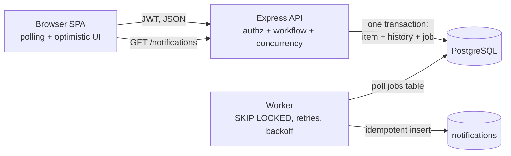
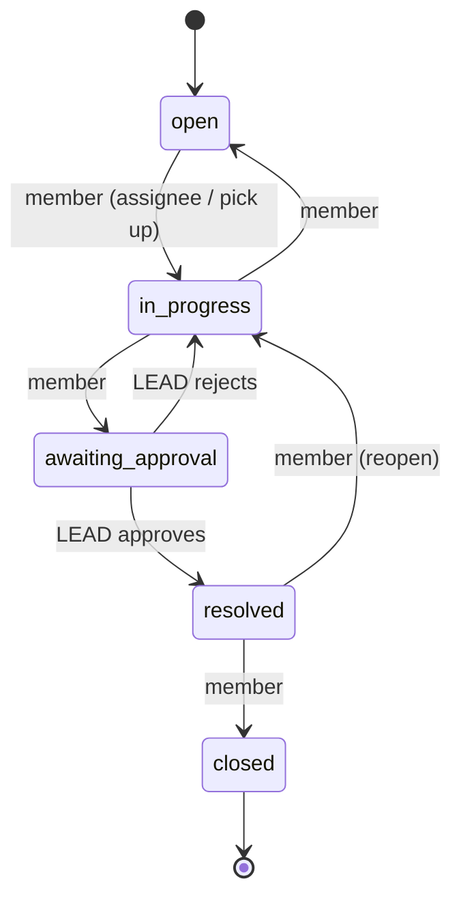

# Ops Desk — Newtonite "Operations Under Pressure"

An internal web app where teams create, assign, track and resolve operational work items (incidents, customer
issues, payments, compliance requests, tasks) — built so that it stays **correct when people collide**:
two people claiming the same item, stale edits, double-clicked/retried requests, failed background work.

* **Stack:** Node.js 22 + Express · PostgreSQL 16 · framework-free browser SPA (no build step) · `node:test` + Supertest
* **Individual work.** Every decision is explained in [`ENGINEERING_DECISIONS.md`](./ENGINEERING_DECISIONS.md).

## Run it (one command)

Prerequisite: Docker with Compose.

```bash
docker compose up --build
# open http://localhost:3000
```

This starts Postgres, the API + UI (applies the schema and seeds **4 teams, 10 users, 5 000 items**), and the background worker.

### Demo logins (password for all: `password123`)

| User | Roles |
|---|---|
| `alice@demo.test` | **admin** in all 4 teams |
| `bob@demo.test` | **lead** in Support, member in Engineering |
| `carol@demo.test` | **lead** in Engineering |
| `dave@demo.test` | **lead** in Payments |
| `erin@demo.test` | **lead** in Compliance, member in Payments |
| `frank@demo.test` | member in Support |
| `grace@demo.test` | member in Engineering |
| `heidi@demo.test` | member in Payments + Compliance |
| `ivan@demo.test` | **viewer** in Support + Engineering (read-only) |
| `judy@demo.test` | member in Support + Payments |

### Run the tests

```bash
docker compose run --rm app npm test
```

Tests use a **separate database** (`ops_test`, created automatically; the harness refuses any DB whose name lacks `test`).

### Without Docker

Needs Node ≥ 20.6 and a local Postgres ≥ 12.

```bash
cp .env.example .env          # adjust DATABASE_URL
npm install
npm run migrate && npm run seed
npm run dev                   # terminal 1: API + UI on :3000
npm run worker                # terminal 2: background jobs
npm test
```

## What the app does

* **Work items** have a type, priority, status, team, assignee, due date, a version number and a full history.
* **Workflow** (enforced on the server): `open → in_progress → awaiting_approval → resolved → closed`.
  Only a **Lead/Admin of the item's team** can pass the approval step (approve → `resolved`, or reject → `in_progress`).
* **Dashboard**: *Assigned to me*, *Unassigned urgent*, *Awaiting my approval* (live counts) + *All items* with
  search, filters and server-side cursor pagination.
* **History**: an append-only timeline of every owner / priority / status / field change plus comments.
* **Notifications**: assignment and approval requests are delivered asynchronously by a worker (outbox pattern).





### Roles × actions (per team; enforced in `src/permissions.js`, the single decision point)

| Action | viewer | member | lead | admin |
|---|:-:|:-:|:-:|:-:|
| view items, history | ✅ | ✅ | ✅ | ✅ |
| create, comment, claim, edit fields/priority | | ✅ | ✅ | ✅ |
| move an item through the workflow | | own items* | any | any |
| **approve / reject** (`awaiting_approval → …`) | | | ✅ | ✅ |
| **reassign** to someone else | | | ✅ | ✅ |
| release own assignment | | ✅ | ✅ | ✅ |

\*A member may move items they are assigned to, or pick up an unassigned `open` item (which assigns it to them).
A user who is **not in the item's team** gets `404` (existence is not revealed); a member with too low a role gets `403`.

## Critical behaviours (each has automated tests in `tests/critical.test.js`)

| Situation | How it is handled | Test |
|---|---|---|
| Two users claim the same item | single conditional `UPDATE … WHERE assignee_id IS NULL`; loser gets **409** | 6 parallel claims → exactly one 200 |
| Editing a stale version | optimistic locking (`version`, row lock); mismatch → **409 + latest item** | stale edit rejected, data unchanged; parallel edits → one wins |
| Repeated request (double click / retry) | `Idempotency-Key` header; key + result stored in the same transaction | same key ×2 and ×5 in parallel → one item |
| Workflow rules | allowed-transition map + role gate on the server | invalid jump → 422; non-lead approval → 403 |
| Resource-level authorization | every read/write scoped to the user's teams & role | other team → 404 on all endpoints; viewer → 403 |
| History never disagrees with the item | item change + event + job in **one transaction**; DB trigger makes events append-only | failed changes leave no history; UPDATE/DELETE on events rejected |
| Reliable async work | transactional outbox, `FOR UPDATE SKIP LOCKED`, exponential backoff, max attempts, idempotent handler | re-delivered job → one notification; failing job → retries then `failed` |
| Optimistic UI | UI updates instantly, rolls back and shows the server's reason on 403/409 | verified manually in a browser (see demo script) |

## API (all under `/api`, `Authorization: Bearer <token>`)

| Method & path | Purpose |
|---|---|
| `POST /auth/login` | `{email, password}` → `{token, user}` |
| `GET /me` · `GET /teams/:id/members` | current user + team roles · assignable members |
| `GET /items?view=&status=&priority=&type=&team_id=&assignee=&q=&cursor=&limit=` | filtered, searched, keyset-paginated list |
| `GET /dashboard/counts` | the three "needs attention" counters |
| `POST /items` | create (idempotent with `Idempotency-Key`) |
| `GET /items/:id` · `PATCH /items/:id` | detail with `can` flags · update `{version, …fields}` |
| `POST /items/:id/claim` | atomic claim |
| `POST /items/:id/transition` | `{to, version, comment?}` |
| `POST /items/:id/comments` · `GET /items/:id/activity?cursor=` | comments · paginated history |
| `GET /notifications` · `POST /notifications/read-all` | async-delivered notifications |

Error contract: `400` validation · `401` auth · `403` role too low · `404` not found / not your team · `409` conflict
(body contains `current`) · `422` invalid transition / reused idempotency key with different payload.

## Project layout

```
src/schema.sql      tables, constraints, indexes, append-only trigger
src/permissions.js  role matrix + authorize()        src/workflow.js  allowed transitions
src/items.js        commands (create/claim/update/transition/comment) + queries
src/idempotency.js  Idempotency-Key wrapper           src/jobs.js      outbox processor + handlers
src/routes.js       HTTP layer                        src/worker.js    worker loop
src/seed.js         demo data                         public/          SPA (app.js, style.css)
tests/              critical-behaviour tests
```

## Known limitations

* Passwords are seeded demo credentials; no sign-up, password reset, rate limiting or token revocation (JWT lives 8 h).
* No real e-mail/Slack delivery — "notification" = a row shown in the bell menu (the outbox is the seam for real delivery).
* Live updates use 15 s polling, not websockets. A page being edited is never overwritten; conflicts surface on save (409).
* A lead can approve an item they are assigned to (no separation-of-duties rule yet).
* Search is prefix full-text on title/description (`simple` config, no stemming/typo tolerance).
* Roles are per team; there is no UI to manage users/teams/roles (seed only).
* No frontend automated tests; the UI flow was verified manually in a browser.
* `idempotency_keys` and finished `jobs` are never purged (a retention job would be needed).

## Demo script (3–5 min)

1. Login as **frank** → dashboard counters → *Unassigned urgent* → open an item → **Claim** (double-click: still one claim; see *History*).
2. In a second window as **bob**, edit the same item; back in frank's window change the priority → **409 banner**, UI rolls back, *reload* fixes it.
3. Frank moves it to *awaiting approval* → bob sees it under *Awaiting my approval* (and a notification arrives via the worker) → **Approve**.
4. Login as **ivan** (viewer): read-only; try the API with his token → 403.
5. Show `npm test` passing and the worker/outbox tests.
